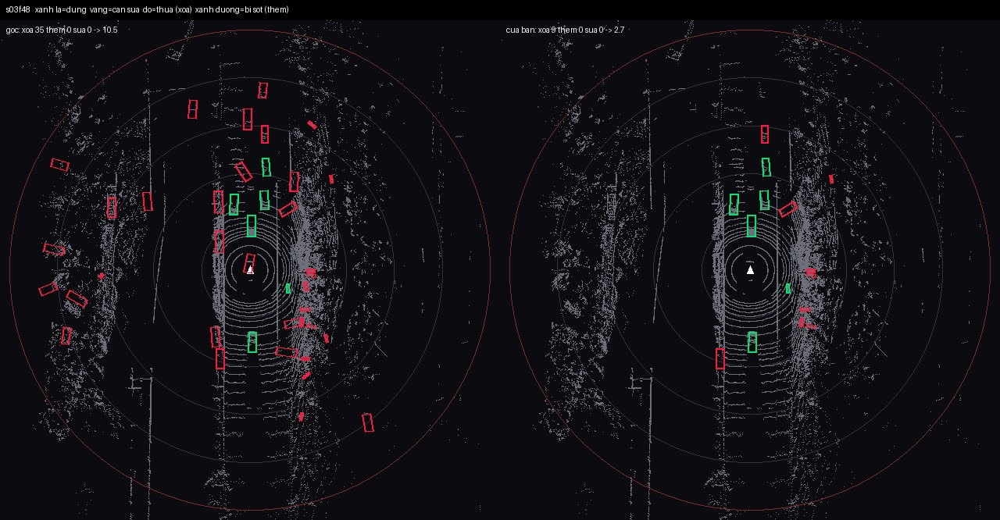

# Báo cáo Day 14 — Đinh Quốc Tiến — 2A202603028

- Mã học viên dùng với `--student`: `2A202603028`
- `seed_tag` trong `frames_A.txt`: `393590736f`

## 1. Dự đoán trước sweep (bước 5b)

- Tham số tôi nghĩ giảm công sửa nhiều nhất: `score_thr`, tăng ngưỡng từ mức gốc `0.1`.
- Vì sao: ảnh BEV tập A có nhiều cuboid dự đoán; tổng cộng `pred_A.json` có 103 box trên 3 frame, trong khi sau khi rà soát tôi giữ 36 box trong `ref_A.json`. Chênh lệch này khiến tôi nghiêng về khả năng box thừa đang chiếm ưu thế. Tôi dự đoán tăng `score_thr` sẽ loại được một phần box điểm thấp và giảm công xóa. Đây là dự đoán trước khi xem kết quả sweep; ngưỡng quá cao có thể làm sót vật thể.

## 2. Tập A: sửa tay và tune

| Cấu hình | Xóa | Thêm | Sửa | Chi phí |
|---|---:|---:|---:|---:|
| Gốc | 70 | 3 | 3 | 25.5 |
| `best_config.json` | 20 | 12 | 2 | 19.0 |

- Tham số đã đổi trong `best_config.json`: `score_thr` từ `0.1` lên `0.5`; `min_points` giữ `0`.
- Tập B dùng `score_thr=0.5` vì ngưỡng này đạt tổng chi phí thấp nhất trên ba frame A (19.0). Cả ba giá trị `min_points` là 0, 5 và 10 đều cho cùng kết quả ở ngưỡng này. Script lấy cấu hình đầu tiên trong ba cấu hình đồng hạng, nên `min_points=0`.
- Kết quả leave-one-out (chọn cấu hình trên hai frame rồi chấm frame còn lại)

  | Frame được giữ lại để chấm | `score_thr` | `min_points` | Chi phí trên frame giữ lại | Chi phí thấp nhất trong grid trên frame đó |
  |---|---:|---:|---:|---:|
  | s01f49 | 0.5 | 0 | 8.5 | 6.0 |
  | s02f11 | 0.5 | 0 | 7.8 | 7.7 |
  | s03f48 | 0.4 | 10 | 4.5 | 2.7 |
- Cấu hình có ổn định trên từng frame không? Không hoàn toàn: hai frame chọn `score_thr=0.5, min_points=0`, còn `s03f48` chọn `score_thr=0.4, min_points=10`. Với chỉ 3 frame, cấu hình có thể bị overfit.

## 3. Trước/sau (bước 8)

- `scripts/pp_compare.py` báo giảm 25% công sửa trên tập A (chi phí từ 25.5 xuống 19.0).
- Dự đoán ở mục 1 đúng hay sai? Đúng về hướng giảm box thừa: số box cần xóa giảm từ 70 xuống 20. Đổi lại, số box cần thêm tăng từ 3 lên 12; mức giảm ròng là 6.5 điểm chi phí.

## 4. Tập B

Số đo từ `scripts/pp_prelabel.py --frames d14_2A202603028/frames_B.txt --config d14_2A202603028/best_config.json --gt d14_2A202603028/ref_B.json`:

| Xóa | Thêm | Sửa | Chi phí |
|---:|---:|---:|---:|
| 68 | 8 | 3 | 29.9 |

- Loại box tốn công sửa nhất ở tập B: box thừa, cần xóa 68 box (20.4 điểm trong tổng chi phí 29.9).

## 5. Giới hạn

- Chỉ có 3 frame A để chọn cấu hình; leave-one-out cũng cho thấy cấu hình được chọn thay đổi theo frame.
- Chi phí là công thức ước lượng trên box trong phạm vi 50 m, không phải thời gian thao tác thực tế trên CVAT.
